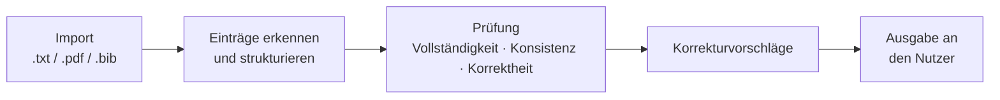
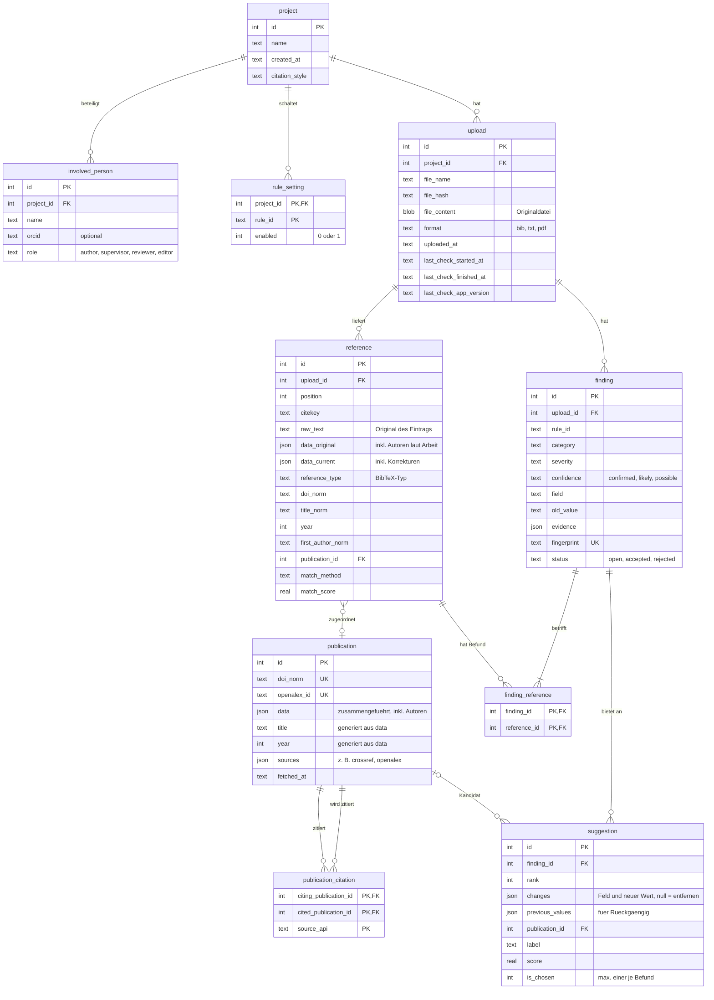

# BOBR – Back-check Of Bibliographic Records

> Open-Source-Werkzeug mit grafischer Oberfläche, das Literaturverzeichnisse auf formale Vollständigkeit, Konsistenz und Korrektheit prüft und Korrekturvorschläge macht.

**Status:** Konzeptionsphase

---

## Problemstellung

In Forschungsprojekten, wissenschaftlichen und studentischen Arbeiten sowie Forschungsanträgen kommen durch manuelle und (teil-)automatisierte Recherche schnell große Mengen an Quellen zusammen. Editoren, Gutachter und Autoren stehen dann vor der Frage, wie sich solche Literaturlisten effizient auf formale Vollständigkeit, Konsistenz und Korrektheit prüfen und korrigieren lassen.

Bestehende Tools wie [GROBID](https://github.com/kermitt2/grobid) decken nur Teile dieses Prozesses ab. Andere Lösungen sind kostenpflichtig oder für nicht-technische Anwender zu komplex.

## Ziel

BOBR soll bibliographische Daten einlesen, prüfen und dem Nutzer verständliche Korrekturvorschläge liefern, und zwar über eine einfache grafische Oberfläche.

## Funktionsumfang (geplant)

**Kernfunktionen**

- Import von Literaturdaten aus `.txt`, `.pdf` und `.bib`
- Prüfung auf **Vollständigkeit**, z. B. fehlende Pflichtangaben
- Prüfung auf **Konsistenz**, z. B. einheitliche Schreibweisen und Formate
- Prüfung auf **Korrektheit** der Angaben
- Korrekturvorschläge, übersichtlich für den Nutzer aufbereitet
- Grafische Oberfläche, die auch ohne technische Vorkenntnisse bedienbar ist

**Erweiterungen (wenn möglich)**

- Erkennen, welche der verwendeten Quellen sich gegenseitig zitieren
- Verknüpfungen zwischen Quellen, Autoren und Gutachtern prüfen und mögliche Interessenkonflikte aufzeigen

**Nicht Teil des Projekts**

- Inhaltliche Prüfung, also ob eine Aussage tatsächlich durch die zitierte Quelle belegt wird

## Ablauf (Konzept)



## Installation

Folgt mit dem ersten Release. Geplant sind fertige Programme für **Windows** und **macOS** zum Download unter [Releases](../../releases).

## Technologie

| Bereich | Technologie | Begründung |
|---------|-------------|------------|
| Sprache | Python | Vorgabe (RB4) |
| GUI | PyQt6 | Plattformübergreifend (Windows + macOS), aktiv gepflegt |
| Datenbank | Neo4j Community Edition (GPL v3) | Graphdatenbank für Zitiernetzwerk und Beziehungen zwischen Quellen |
| BibTeX-Import | bibtexparser | Etablierte Python-Bibliothek für .bib-Dateien |
| PDF-Import | pdfplumber | Zuverlässige Textextraktion aus PDFs |
| Tests | pytest | Standard-Testframework für Python |
| Linting | black + flake8 | Einheitliche Codeformatierung im Team |

> **Voraussetzung:** Neo4j Community Edition muss lokal installiert sein bevor die Anwendung gestartet wird. Download unter [neo4j.com/download](https://neo4j.com/download/).

## Projektstruktur

```
BOBR/
├── src/
│   ├── main.py                  # Einstiegspunkt der Anwendung
│   ├── model/                   # Daten, Importlogik, Validierung, Datenbankzugriff
│   │   ├── literature.py        # Datenmodell für Literatureinträge
│   │   ├── importer/            # Datei-Import (.bib, .txt, .pdf)
│   │   │   ├── bib_importer.py
│   │   │   ├── txt_importer.py
│   │   │   └── pdf_importer.py
│   │   ├── validator/           # Prüflogik (Vollständigkeit, Konsistenz, Korrektheit)
│   │   │   ├── completeness.py
│   │   │   ├── consistency.py
│   │   │   └── correctness.py
│   │   └── database/            # Neo4j-Datenbankanbindung
│   │       └── db.py
│   ├── view/                    # GUI-Komponenten (PyQt6)
│   │   ├── main_window.py
│   │   ├── import_view.py
│   │   └── results_view.py
│   └── controller/              # Steuerung des Ablaufs zwischen Model und View
│       ├── app_controller.py
│       ├── import_controller.py
│       ├── validator_controller.py
│       └── correction_controller.py
├── tests/                       # Unit- und Integrationstests (pytest)
├── docs/                        # Anforderungen und Architekturdokumente
├── .gitignore
└── requirements.txt
```

## Projektorganisation

- **Aufgaben und Fortschritt:** GitHub Projects → [Projektboard](LINK-ZUM-BOARD)
- **Fehler, Ideen, Fragen:** über [Issues](../../issues)

## Meilensteine

| Zeitpunkt | Meilenstein |
|---|---|
| Ende 5. Semester | Zwischenpräsentation |
| Ende 6. Semester | Abschlusspräsentation und Abgabe der schriftlichen Ausarbeitung |

## Projektkontext

Studentisches Projekt im Studiengang Wirtschaftsinformatik – Business Engineering an der [DHBW Ravensburg](https://www.dhbw-ravensburg.de) (Kurse WWIBE124 und WWIBE224).

- **Auftraggeber:** Prof. Dr. Martin Zaefferer

## Lizenz

BOBR wird als Open-Source-Software veröffentlicht. Die konkrete Lizenz wird mit dem Auftraggeber abgestimmt.


---

# Gefundene Tools

Für den Graphen:
https://networkx.org/documentation/stable/auto_examples/index.html


---

# BOBR – Datenbankschema (ER-Diagramm, Version 0.8)

Entspricht `bobr_schema.sql` mit `PRAGMA user_version = 8`. GitHub stellt den Mermaid-Block direkt als Diagramm dar.

## Begriffe

| Tabelle | Bedeutung |
|---|---|
| `project` | eine geprüfte Arbeit (Paper, Abschlussarbeit, Antrag) = eine `.bobr`-Datei |
| `involved_person` | an der geprüften Arbeit beteiligte Person: Autor, Betreuer, Gutachter, Herausgeber (für Interessenkonflikt-Hinweise) |
| `rule_setting` | Prüfregel im Projekt an- oder abgeschaltet (keine Zeile = Standard der Regel) |
| `upload` | eine hochgeladene Literaturliste samt Originaldatei; jeder Upload ist eine eigene, gespeicherte Prüfung |
| `reference` | eine Quelle aus der Literaturliste, so wie der Autor sie angegeben hat |
| `publication` | die tatsächliche Veröffentlichung, so wie Crossref, OpenAlex usw. sie kennen |
| `publication_citation` | Veröffentlichung A zitiert Veröffentlichung B (Kante im Zitationsgraphen) |
| `finding` | ein Befund |
| `finding_reference` | welche Quellen ein Befund betrifft (meist eine, bei Dubletten oder Zyklen mehrere) |
| `suggestion` | ein Korrekturvorschlag; kann mehrere Felder ändern und lässt sich rückgängig machen |

## Änderungen gegenüber 0.7

- `check_run` entfällt; der Stand der letzten Prüfung steht in `upload` (`last_check_*`).
- `upload.file_content` speichert die Originaldatei (Export behält `@string`, `@preamble`, Kommentare und Reihenfolge).
- `reference`: `project_id`, `raw_hash`, `content_hash` entfallen; Indizes laufen über den Upload; `reference_type` = BibTeX-Typ wie in der Datei.
- `publication`: `sources` (JSON-Liste) statt `fetched_from`; `title` und `year` werden aus `data` generiert.
- `publication_citation`: eine Veröffentlichung kann sich nicht selbst zitieren (CHECK).
- `finding`: `check_run_id` entfällt; Status nur noch `open`, `accepted`, `rejected`; Fingerprint aus Regel + Feld + IDs der betroffenen Quellen.
- `suggestion.previous_values` hält beim Annehmen die überschriebenen Werte fest (Rückgängig).

Vereinfachung im Bild: `fingerprint` ist nur innerhalb eines Uploads eindeutig (Index auf `upload_id` + `fingerprint`).


