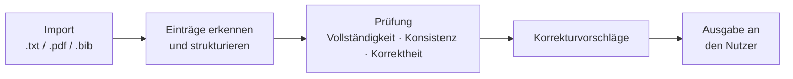

# BOBR – Back-check Of Bibliographic Records

> Open-Source-Werkzeug mit grafischer Oberfläche, das Literaturverzeichnisse auf formale Vollständigkeit, Konsistenz und Korrektheit prüft und Korrekturvorschläge macht.

**Status:** Konzeptionsphase

---

## Problemstellung

In Forschungsprojekten, wissenschaftlichen und studentischen Arbeiten sowie Forschungsanträgen kommen durch manuelle und (teil-)automatisierte Recherche schnell große Mengen an Quellen zusammen. Editoren, Gutachter und Autoren stehen dann vor der Frage, wie sich solche Literaturlisten effizient auf formale Vollständigkeit, Konsistenz und Korrektheit prüfen und korrigieren lassen.

Bestehende Tools wie [GROBID](https://github.com/kermitt2/grobid) decken nur Teile dieses Prozesses ab. Andere Lösungen sind kostenpflichtig oder für nicht-technische Anwender zu komplex.

## Ziel

BOBR soll bibliographische Daten einlesen, prüfen und dem Nutzer verständliche Korrekturvorschläge liefern, und zwar über eine einfache grafische Oberfläche.

## Funktionsumfang (geplant)

**Kernfunktionen**

- Import von Literaturdaten aus `.txt`, `.pdf` und `.bib`
- Prüfung auf **Vollständigkeit**, z. B. fehlende Pflichtangaben
- Prüfung auf **Konsistenz**, z. B. einheitliche Schreibweisen und Formate
- Prüfung auf **Korrektheit** der Angaben
- Korrekturvorschläge, übersichtlich für den Nutzer aufbereitet
- Grafische Oberfläche, die auch ohne technische Vorkenntnisse bedienbar ist

**Erweiterungen (wenn möglich)**

- Erkennen, welche der verwendeten Quellen sich gegenseitig zitieren
- Verknüpfungen zwischen Quellen, Autoren und Gutachtern prüfen und mögliche Interessenkonflikte aufzeigen

**Nicht Teil des Projekts**

- Inhaltliche Prüfung, also ob eine Aussage tatsächlich durch die zitierte Quelle belegt wird

## Ablauf (Konzept)



## Installation

**Voraussetzungen:** Python 3.11+, Node.js 18+

**Backend starten** (aus dem Repo-Root, nicht aus `backend/`):
```bash
python -m venv .venv
source .venv/bin/activate  # macOS
.venv\Scripts\activate     # Windows
pip install -r requirements.txt
uvicorn backend.app:app --reload --port 8000
```

**Backend testen:**
```bash
pytest
```

**Datenbank:** Uploads und Prüfungen werden dauerhaft in einer SQLite-Datei gespeichert und sind nach einem Neustart wieder da. Die Datei wird beim ersten Request automatisch angelegt:

| System | Standardpfad |
|---|---|
| Windows | `%LOCALAPPDATA%\BOBR\bobr.db` |
| macOS | `~/Library/Application Support/BOBR/bobr.db` |
| Linux | `$XDG_DATA_HOME/bobr/bobr.db` bzw. `~/.local/share/bobr/bobr.db` |

Mit der Umgebungsvariable `BOBR_DB_PATH` lässt sich ein anderer Pfad setzen (z. B. für eine Demo-Datenbank). `backend/bobr.sqlite` ist nur die leere Schema-Vorlage und wird nie beschrieben. Zum kompletten Zurücksetzen das Backend stoppen und die Datei `bobr.db` löschen.

**Frontend starten:**
```bash
cd frontend
npm install
npm run dev
```

**Frontend testen:**
```bash
cd frontend
npm test
```

Tests befinden sich in `frontend/src/tests/`:
- `ImportView.test.js` — Dateiauswahl, Anzeige, Navigation (4 Tests)
- `ResultsView.test.js` — Anzeige, Annehmen/Ablehnen, Leerzustand (5 Tests)
- `api.test.js` — API-Aufrufe mit gemocktem axios (4 Tests)

Danach:
- Frontend: `http://localhost:5173`
- Backend API: `http://localhost:8000`
- API-Dokumentation: `http://localhost:8000/docs`

## Backend-API

Jeder Upload ist eine eigene, gespeicherte Prüfung (Uploads werden nicht zusammengeführt). Basis-URL: `http://localhost:8000/api`.

| Methode | Pfad | Zweck |
|---|---|---|
| POST | `/import/` | Datei (`.bib`, `.txt`, `.pdf`) hochladen und als neue Prüfung speichern |
| POST | `/validate/` | Zuletzt gespeicherten Upload prüfen; mit `?upload_id=<id>` einen bestimmten |
| POST | `/corrections/{id}/accept` | Finding annehmen |
| POST | `/corrections/{id}/reject` | Finding ablehnen |
| GET | `/uploads` | Alle gespeicherten Prüfungen, neueste zuerst |
| GET | `/uploads/{id}` | Eine Prüfung mit allen Findings und allen erkannten Quellen |
| DELETE | `/uploads/{id}` | Eine Prüfung samt Quellen und Findings löschen |

**`POST /import/`** (Formularfeld `file`), Antwort:
```json
{
  "count": 2,
  "filename": "literatur.bib",
  "upload_id": 3,
  "notice": "Diese Datei wurde bereits am 2026-11-20 09:15:02 (UTC) hochgeladen (Prüfung #1). Sie wurde trotzdem als neue Prüfung gespeichert.",
  "duplicate_of": [1]
}
```
`notice` ist `null` und `duplicate_of` leer, wenn die Datei (gleicher Inhalt) noch nicht gespeichert ist. Nicht lesbare Dateien: `422`, es wird nichts gespeichert.

**`POST /validate/`**, Antwort: Liste der neu angelegten Findings:
```json
[{ "id": 12, "type": "fehler", "field": "Vollständigkeit", "message": "Pflichtfelder fehlen bei b1: publisher, year", "suggestion": "Fehlende Felder ergänzen" }]
```
`type` ist `fehler` oder `warnung`. Bereits angenommene oder abgelehnte Findings werden bei einer erneuten Prüfung nicht noch einmal geliefert; offene werden neu erzeugt (mit neuer `id`). Fehler: `400` (noch nichts importiert), `404` (unbekannte `upload_id`), `409` (gespeicherte Datei ergibt eine andere Anzahl an Quellen als beim Upload).

**`POST /corrections/{id}/accept`** bzw. **`/reject`**, Antwort: `{"status": "accepted", "id": 12}`, `404` bei unbekannter ID.

**`GET /uploads`**, Antwort:
```json
[{
  "id": 3, "file_name": "literatur.bib", "format": "bib", "uploaded_at": "2026-11-20 09:20:11",
  "last_check_started_at": "2026-11-20 09:20:15", "last_check_finished_at": "2026-11-20 09:20:16",
  "reference_count": 2,
  "finding_counts": { "open": 3, "accepted": 1, "rejected": 0 }
}]
```
`last_check_started_at` ist `null`, wenn der Upload noch nie geprüft wurde. Ist nur der Start gesetzt, wurde die Prüfung abgebrochen.

**`GET /uploads/{id}`**: dieselben Felder wie in der Liste, dazu:
- `findings` im Format von `/validate/`, ergänzt um `status` (`open`, `accepted`, `rejected`) und `reference_ids` (IDs der betroffenen Quellen),
- `references`: alle erkannten Quellen in Dateireihenfolge.

```json
"references": [{
  "id": 17, "position": 1, "citekey": "a1", "type": "article",
  "title": "Ein Titel", "authors": ["Smith, John", "Doe, Jane"], "year": 2020,
  "container": "Journal of Examples", "publisher": null,
  "doi": "10.1000/abc", "isbn": null, "url": null,
  "raw_text": null
}]
```
`raw_text` ist der Originaltext der Quelle bei `.txt`/`.pdf` (zeigt, was der Importer zerlegt hat), bei `.bib` `null`. `404` bei unbekannter ID.

**`DELETE /uploads/{id}`**, Antwort: `{"deleted": 3}`, `404` bei unbekannter ID. Andere Prüfungen bleiben erhalten.

Alle Zeitangaben sind UTC im Format `YYYY-MM-DD HH:MM:SS`.

## Technologie

| Bereich | Technologie | Begründung |
|---------|-------------|------------|
| Backend | Python + FastAPI | Vorgabe Python (RB4), FastAPI für REST API |
| Frontend | Vue 3 + Tailwind CSS | Modernes Framework, Tailwind für flexibles Styling |
| Datenbank | SQLite | In Python enthalten, keine Installation nötig, läuft lokal |
| BibTeX-Import | bibtexparser | Etablierte Python-Bibliothek für .bib-Dateien |
| PDF-Import | pdfplumber | Zuverlässige Textextraktion aus PDFs |
| Tests | pytest | Standard-Testframework für Python |
| Linting | black + flake8 | Einheitliche Codeformatierung im Team |

## Projektstruktur

```
BOBR/
├── backend/
│   ├── main.py                  # FastAPI Einstiegspunkt
│   ├── api/                     # REST API Routen
│   │   ├── import_routes.py
│   │   ├── validator_routes.py
│   │   └── correction_routes.py
│   ├── model/                   # Daten, Importlogik, Validierung, Datenbankzugriff
│   │   ├── literature.py        # Datenmodell für Literatureinträge
│   │   ├── importer/            # Datei-Import (.bib, .txt, .pdf)
│   │   │   ├── bib_importer.py
│   │   │   ├── txt_importer.py
│   │   │   └── pdf_importer.py
│   │   ├── validator/           # Prüflogik (Vollständigkeit, Konsistenz, Korrektheit)
│   │   │   ├── completeness.py
│   │   │   ├── consistency.py
│   │   │   └── correctness.py
│   │   └── database/            # Neo4j-Datenbankanbindung
│   │       └── db.py
│   └── controller/              # Steuerung des Ablaufs zwischen Model und API
│       ├── import_controller.py
│       ├── validator_controller.py
│       └── correction_controller.py
├── frontend/
│   ├── src/
│   │   ├── main.js              # Vue Einstiegspunkt
│   │   ├── App.vue
│   │   ├── views/               # Seiten
│   │   │   ├── ImportView.vue
│   │   │   └── ResultsView.vue
│   │   ├── components/          # Wiederverwendbare UI-Komponenten
│   │   └── services/            # API-Aufrufe ans Backend
│   │       └── api.js
│   └── package.json
├── tests/                       # Unit- und Integrationstests (pytest)
├── docs/                        # Anforderungen und Architekturdokumente
├── .gitignore
└── requirements.txt
```

## Projektorganisation

- **Aufgaben und Fortschritt:** GitHub Projects → [Projektboard](LINK-ZUM-BOARD)
- **Fehler, Ideen, Fragen:** über [Issues](../../issues)

## Meilensteine

| Zeitpunkt | Meilenstein |
|---|---|
| Ende 5. Semester | Zwischenpräsentation |
| Ende 6. Semester | Abschlusspräsentation und Abgabe der schriftlichen Ausarbeitung |

## Projektkontext

Studentisches Projekt im Studiengang Wirtschaftsinformatik – Business Engineering an der [DHBW Ravensburg](https://www.dhbw-ravensburg.de) (Kurse WWIBE124 und WWIBE224).

- **Auftraggeber:** Prof. Dr. Martin Zaefferer

## Lizenz

BOBR wird als Open-Source-Software veröffentlicht. Die konkrete Lizenz wird mit dem Auftraggeber abgestimmt.


---

# Gefundene Tools

Für den Graphen:
https://networkx.org/documentation/stable/auto_examples/index.html

