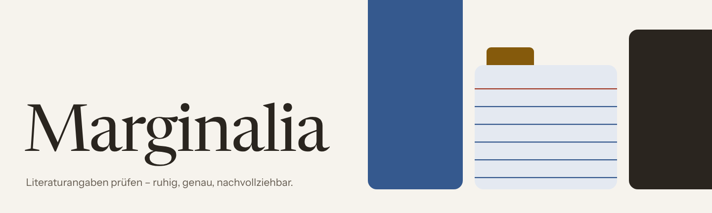
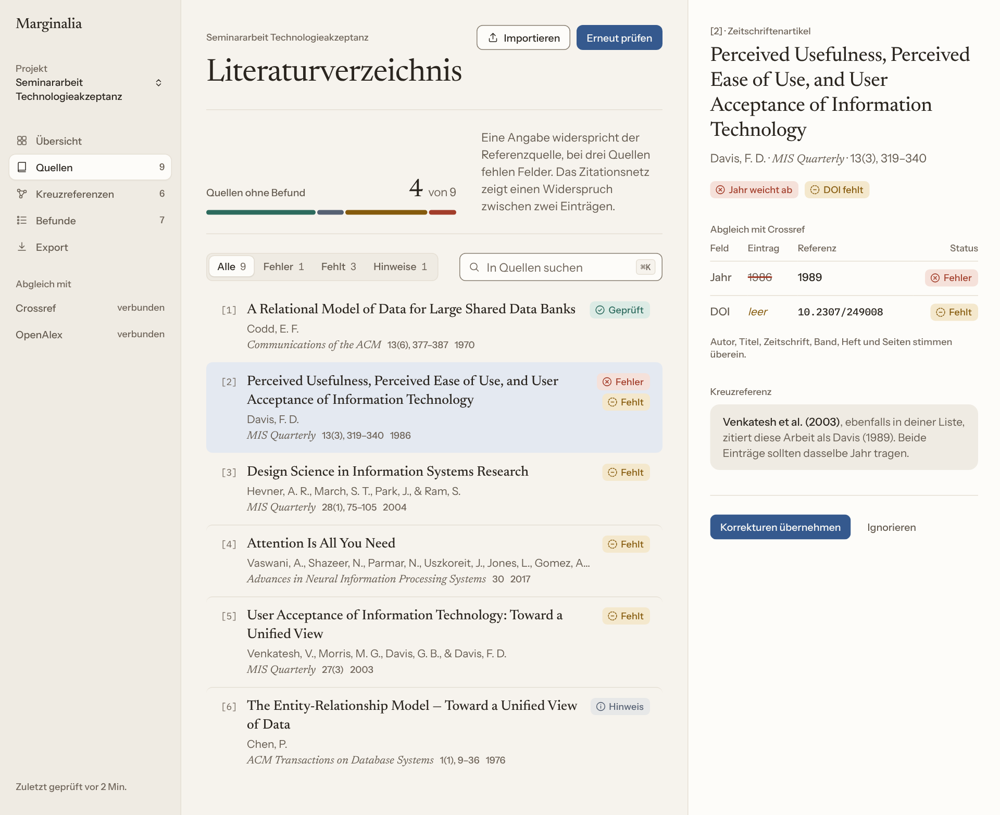
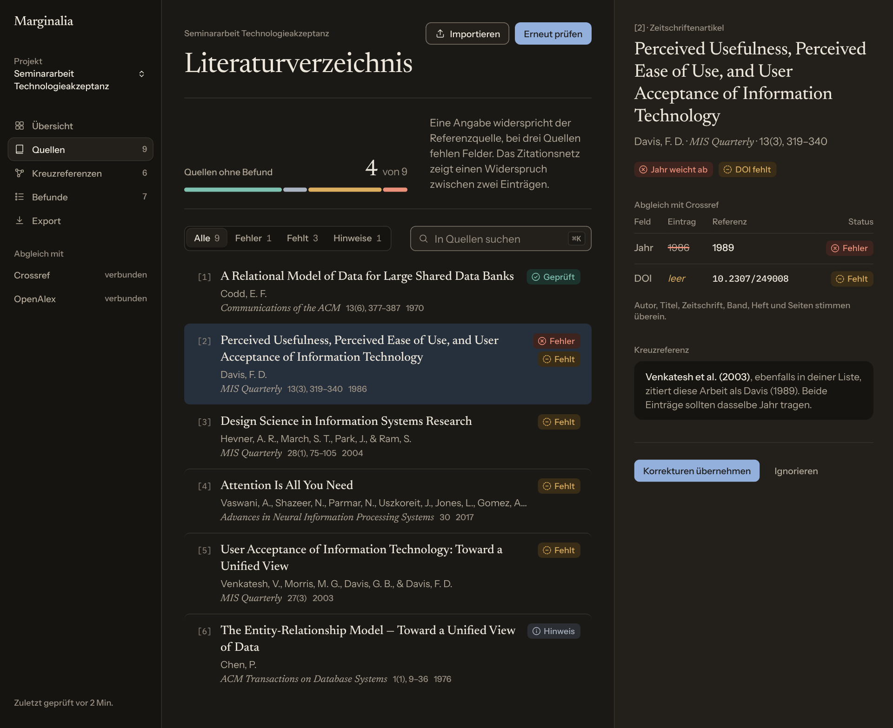

# Marginalia — Design System



Design System für ein Werkzeug, das Literaturverzeichnisse wissenschaftlicher Arbeiten prüft: Autoren, Jahr, Titel, Zeitschrift, Seiten und DOI werden mit Referenzquellen wie Crossref abgeglichen, fehlerhafte und fehlende Angaben markiert und Widersprüche zwischen den Quellen einer Liste sichtbar gemacht.

Warmes Papier statt grellem Weiß, Serifen für die Werke, eine leise Bedienung — gemacht für langes Arbeiten. Zwei Themes: **Papier** (hell) und **Abend** (dunkel).

| Papier | Abend |
| --- | --- |
|  |  |

## Schnellstart

Die Komponenten sind reines CSS und funktionieren mit jedem Framework (React, Vue, Svelte, reines HTML).

```html
<!doctype html>
<html lang="de" data-theme="light">            <!-- oder data-theme="dark" -->
<head>
  <meta charset="utf-8">
  <link rel="stylesheet" href="tokens/tokens.css">
  <link rel="stylesheet" href="css/marginalia.css">
</head>
<body>
  <h1 class="display">Literaturverzeichnis</h1>
  <button class="mg-btn mg-btn--primary">Liste prüfen</button>
  <span class="mg-status mg-status--error">
    <svg class="mg-icon" viewBox="0 0 24 24" aria-hidden="true"><circle cx="12" cy="12" r="9"/><path d="M15 9l-6 6M9 9l6 6"/></svg>
    Fehler
  </span>
</body>
</html>
```

- **Farben, Abstände, Radien, Schatten** sind CSS-Variablen (`var(--accent)`, `var(--space-4)`, `var(--radius-md)` …).
- **Schriftstile** sind Klassen: `display`, `headline`, `work-title`, `body`, `label`, `caption`, `identifier`.
- **Komponenten** sind Klassen mit Präfix `mg-`. Das Markup steht in jedem Komponenten-Ordner.

## Vorschau ansehen

`index.html` im Browser öffnen — dort sind alle Komponenten, die Farben und ein Theme-Umschalter. Jede Komponente lässt sich auch einzeln öffnen (`components/<Name>/index.html`, dunkel mit `?theme=dark`).

Als Webseite: In den Repository-Einstellungen unter **Pages** den Branch `main` und den Ordner `/ (root)` wählen. Die leere Datei `.nojekyll` sorgt dafür, dass GitHub die Dateien unverändert ausliefert.

## Aufbau

```
├── index.html               Übersicht aller Komponenten
├── tokens/
│   ├── tokens.json          Quelle aller Design-Tokens (hier ändern)
│   └── tokens.css           daraus erzeugt: CSS-Variablen, Schriftstile, @font-face
├── css/marginalia.css       Komponenten-Styles (Präfix mg-)
├── components/<Name>/       je Komponente: README.md (Richtlinien) und index.html (Vorschau)
├── fonts/                   Schriftdateien (woff2) und ihre Lizenzen
├── docs/
│   ├── brand-book.md        Gestaltungsregeln: Haltung, Sprache, Farbe, Typografie, Status …
│   ├── cover.html           Titelbild
│   └── images/              Screenshots für dieses README
└── scripts/build-tokens.mjs erzeugt tokens/tokens.css aus tokens/tokens.json
```

## Tokens ändern

1. Werte in `tokens/tokens.json` anpassen.
2. `node scripts/build-tokens.mjs` ausführen (Node 18 oder neuer, keine Abhängigkeiten).
3. `tokens/tokens.css` mit einchecken.

Bei neuen Farben auf den Kontrast achten: Text mindestens 4,5:1 auf seinen Flächen, Rahmen von Bedienelementen und Statusfarben mindestens 3:1 — in beiden Themes. Jede Farbe hat in `tokens.json` eine Notiz, auf welchen Flächen sie verwendet werden darf.

## Komponenten

| Komponente | Zweck |
| --- | --- |
| [Button](components/Button/) | Aktionen; pro Bereich höchstens ein Primär-Button |
| [SegmentedControl](components/SegmentedControl/) | Liste nach Status filtern |
| [Input](components/Input/) | Eingabefeld und Suche |
| [StatusBadge](components/StatusBadge/) | Fehler, Fehlt, Hinweis, Geprüft — immer mit Icon und Wort |
| [CompletenessMeter](components/CompletenessMeter/) | Zustand des Literaturverzeichnisses als Balken |
| [ReferenceRow](components/ReferenceRow/) | Eine Quelle in der Liste |
| [FieldCheck](components/FieldCheck/) | Eintrag gegen Referenzquelle, Feld für Feld |
| [CitationNotes](components/CitationNotes/) | Rohzitat mit markierten Stellen und Randnotizen |
| [CitationGraph](components/CitationGraph/) | Zitationsnetz mit Widersprüchen zwischen Quellen |
| [Workspace](components/Workspace/) | Arbeitsansicht: Seitenleiste, Liste, Detailpanel |

Die Regeln dahinter stehen in [`docs/brand-book.md`](docs/brand-book.md).

## Hinweise

- Die Beispieldaten in den Vorschauen sind bekannte Arbeiten (u. a. Davis 1989, Venkatesh et al. 2003, Codd 1970) mit **absichtlich eingebauten Fehlern**, z. B. Davis mit 1986 statt 1989. Das Zitationsnetz zeigt nur einen Ausschnitt, kein vollständiges Netz dieser Arbeiten.
- Icons sind als Inline-SVG im Stil von [Lucide](https://lucide.dev) gezeichnet; für die App kann direkt Lucide verwendet werden.

## Lizenzen

- **Schriften:** Newsreader, Instrument Sans und IBM Plex Mono stehen unter der SIL Open Font License 1.1 — Lizenztexte in [`fonts/`](fonts/).
- **Alles andere:** noch keine Lizenz festgelegt.
